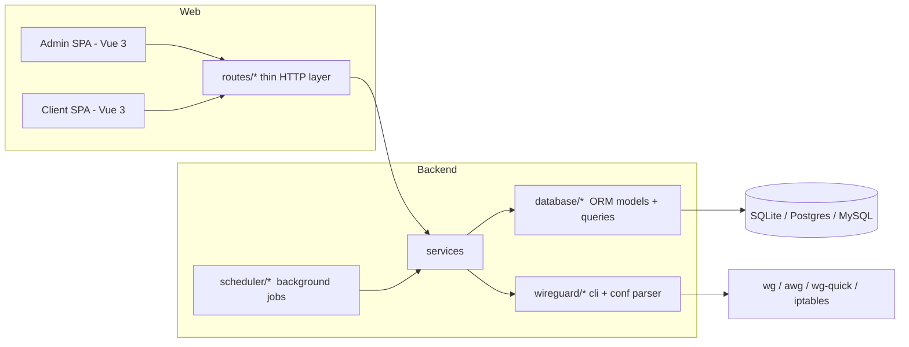
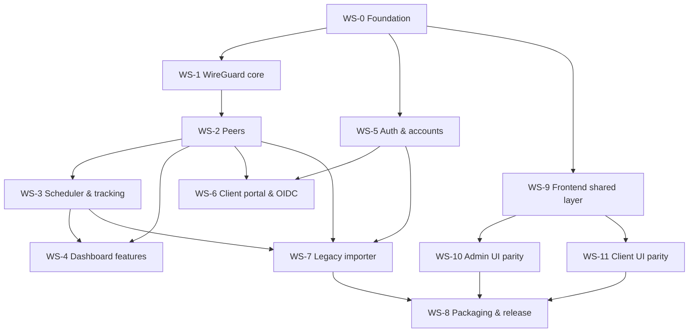

# WGDashboard Rewrite – Roadmap

This document is the single source of truth for the rewrite. It is written so that an
agent (or contributor) can pick up **one workstream** and work on it independently.

- Legacy code (read-only reference): `reference/`
- New code: `src/` (backend + `src/web/` frontends), `docker/`
- Goal: full feature parity with legacy, with an (almost) one-to-one Vue frontend, on a
  modern, readable, tested and secure codebase.

---

## 0. How to use this document (for agents)

1. Read **§1 Ground rules**, **§2 Coding style** and **§3 Architecture** – they apply to every workstream.
2. Pick a workstream from **§7 Workstreams**. Check its *Depends on* list is done.
3. Use the *Legacy reference* files only to understand behaviour. **Do not copy legacy code
   style** – re-implement following §2.
4. Satisfy every item in *Acceptance criteria* before marking the workstream done.
5. Update **§8 Parity checklist** and the endpoint table in **§5** when you finish.
6. Never modify anything inside `reference/`.

Shared agent rules live in [AGENTS.md](../AGENTS.md), style rules in
[.github/instructions/](../.github/instructions/) and role agents in
[.github/agents/](../.github/agents/):

| Agent | Workstreams |
|---|---|
| `wgd-orchestrator` | coordinates all, delegates, updates statuses |
| `wgd-legacy-researcher` | read-only legacy behaviour lookups |
| `wgd-reviewer` | read-only review + lint/tests |
| `wgd-foundation` | WS-0 |
| `wgd-wireguard` | WS-1, WS-2 |
| `wgd-features` | WS-3, WS-4 |
| `wgd-auth` | WS-5, WS-6 |
| `wgd-migration` | WS-7 |
| `wgd-devops` | WS-8 |
| `wgd-frontend` | WS-9, WS-10, WS-11 |

---

## 1. Ground rules

- Readability is the top priority. More lines of clear code beats fewer lines of clever code.
- Routes are thin; business logic lives in services; SQL lives in the database layer;
  subprocess calls live only in `src/modules/wireguard/cli.py`.
- Every new backend feature ships with pytest tests; every new frontend store/composable
  ships with Vitest tests.
- Every schema change ships with an Alembic migration.
- No secrets in logs. No `shell=True`. No raw SQL string formatting.
- Keep the existing response envelope (`make_resp_obj`, see §4.1).

---

## 2. Coding style (mandatory)

The legacy codebase often uses compact, dense constructs. The rewrite deliberately does
the opposite.

### 2.1 Before / after

Legacy (`reference/src/modules/WireguardConfiguration.py` ~L915):
```python
"Total": sum(list(map(lambda x: x.cumu_data + x.total_data, self.Peers))),
"ConnectedPeers": len(list(filter(lambda x: x.status == "running", self.Peers))),
```

Rewrite:
```python
total_data_usage = 0.0
connected_peer_count = 0

for peer in peers:
    total_data_usage += peer.cumulative_data + peer.total_data

    if peer.status == PeerStatus.RUNNING:
        connected_peer_count += 1
```

Legacy (`WireguardConfiguration.py` ~L1170): `list(islice(filter(lambda ip: ..., map(lambda iph: ..., network.hosts())), threshold))`

Rewrite: a named helper `find_available_addresses(network, used_addresses, limit)` with a
plain `for` loop and an early `break`.

### 2.2 Python rules

1. No `lambda`, `map()` or `filter()`. Use `for` loops, or a single-level comprehension with at most one simple `if`.
2. No nested ternaries; a ternary must fit comfortably on one short line.
3. One action per line. Use descriptively named intermediate variables instead of chained calls.
4. Early returns over nested `if/else`. Max ~3 indentation levels inside a function body.
5. Descriptive names: `peer`, `interface_name`, `allowed_ips` – never `p`, `ca`, `iph`, `x`.
6. Type hints on **every** parameter and return value. SQLAlchemy models use 2.0 `Mapped[...]` / `mapped_column`.
7. Error convention: functions return `tuple[bool, value]` (as already used in `config.py`). Be consistent. *(See decision D5.)*
8. Logging (from `GUIDELINES.md`): utility functions ALWAYS log at DEBUG. Services log INFO on state changes and ERROR on failure. Use `import logging as log` as existing modules do.
9. Never `subprocess` with `shell=True`. Arguments are lists. Only `wireguard/cli.py` may call `wg`/`awg`/`wg-quick`/`awg-quick`/`ip`/`iptables`.
10. Function ≲ 50 lines, file ≲ 400 lines. Split by responsibility.
11. Enums / constants instead of magic strings (`PeerStatus`, `Protocol`, `JobAction`, `JobOperator`).
12. Keep existing conventions: `#!/bin/env python3` header, snake_case functions, classes grouping `@staticmethod`s where already used, `'''docstring'''` one-liners.

### 2.3 Vue rules

1. `<script setup>` Composition API only. Stores use `defineStore` setup syntax.
2. Templates contain no logic beyond property access; anything else becomes a named `computed`.
3. Component ≲ 250 lines. Extract composables (`usePeerSorting`, `usePeerFilter`, `usePeerModals`, …).
4. All HTTP goes through the shared API layer (`api.peers.update(...)`), never raw URLs in components.
5. `async/await` only – no callback-style fetch helpers.
6. Explicit `defineProps` (with defaults) and `defineEmits`.
7. Keep component **names and folder structure** aligned with legacy so features can be compared one-to-one.

### 2.4 Tooling (enforces the above)

- Python: `ruff` (enable `E731`, `C901` max 10, `PLR0912`, `PLR0915`, `SIM`, `N`, `ANN`), `pyright` (basic → strict).
- Frontend: `eslint-plugin-vue` (recommended) + `complexity`, `max-lines`, `max-depth`; `prettier`.
- `pre-commit` running all of the above; GitHub Actions CI running lint + tests.

---

## 3. Architecture



### 3.1 Target backend layout

```
src/
  main.py
  modules/
    config/       config.py, config_utils.py, legacy_keys.py
    database/     database.py, database_utils.py, functions.py
                  models/ (one file per domain)
                  alembic/  (migrations)
    wireguard/    conf_parser.py, cli.py, keys.py, ip_allocation.py,
                  interface_service.py, peer_service.py, amnezia.py
    auth/         admin_auth.py, api_keys.py, totp.py, oidc.py
    clients/      client_accounts.py, client_assignments.py, password_reset.py
    features/     peer_jobs.py, share_links.py, backups.py, webhooks.py, email.py,
                  config_templates.py, tracking.py, network_tools.py, plugins.py
    scheduler/    scheduler.py, job_peer_stats.py, job_tracking.py, job_peer_jobs.py
    routes/       response.py, locale.py, routes_utils.py, one routes_<domain>.py per domain
    utilities/    logger.py, statistics.py, utilities.py
  web/
    shared/       api client, locale helper, types, common inputs (new)
    admin/
    client/
    locales/
tests/
  unit/  integration/  fixtures/ (sample .conf files, legacy DB dumps)
tools/
  import_legacy.py
```

### 3.2 Target database schema

Legacy creates **tables per WireGuard configuration** (`{name}`, `{name}_restrict_access`,
`{name}_deleted`, `{name}_transfer`, `{name}_endpoint_history`). The rewrite normalizes this:

| Table | Key columns | Replaces (legacy) |
|---|---|---|
| `interfaces` | id, name (unique), protocol (`wg`/`awg`), private_key, public_key, address, listen_port, mtu, dns, table, pre_up, post_up, pre_down, post_down, save_config, description, autostart | `.conf` metadata, `WireguardConfigurationInfo` |
| `interface_amnezia_params` | interface_id FK, jc, jmin, jmax, s1–s4, h1–h4, i1–i5, j1–j3, itime | Amnezia fields |
| `interface_overrides` | interface_id FK, dns, mtu, keepalive, endpoint, allowed_ips, listen_port | `OverridePeerSettings` |
| `peer_groups` | id, interface_id FK, name, color, icon | `PeerGroups` |
| `peers` | id, interface_id FK, public_key, private_key, preshared_key, name, allowed_ips, endpoint_allowed_ips, dns, mtu, keepalive, remote_endpoint, notes, status (`active`/`restricted`/`deleted`), latest_handshake, endpoint, total_rx/tx, cumulative_rx/tx, group_id | `{name}`, `{name}_restrict_access`, `{name}_deleted` |
| `peer_traffic_samples` | id, peer_id FK, rx, tx, cumulative_rx, cumulative_tx, sampled_at | `{name}_transfer` |
| `peer_endpoint_history` | id, peer_id FK, endpoint, first_seen, last_seen | `{name}_endpoint_history` |
| `peer_jobs` | id, peer_id FK, field, operator, value, action, created_at, expires_at | `PeerJobs` |
| `peer_job_logs` | id, job_id FK, status, message, logged_at | `PeerJobLog` |
| `peer_share_links` | id (token), peer_id FK, shared_at, expires_at | `PeerShareLinks` |
| `users` | id, username, password_hash, role, totp_enabled, totp_verified, totp_secret (encrypted), email | `[Account]` in ini |
| `api_keys` | id, key_hash, created_at, expires_at, description | `DashboardAPIKeys` |
| `clients` | id, email, password_hash, name, totp_secret, totp_verified, created_at, deleted_at | `DashboardClients`, `DashboardClientsInfo` |
| `clients_oidc` | id, client_id FK, issuer, subject | `DashboardOIDCClients` |
| `client_peer_assignments` | id, client_id FK, peer_id FK, assigned_at, unassigned_at | `DashboardClientsPeerAssignment` |
| `client_password_resets` | token, client_id FK, created_at, expires_at | `DashboardClientsPasswordResetLinks` |
| `webhooks` | id, url, content_type, headers JSON, verify_tls, actions JSON, active, notes, created_at | `DashboardWebHooks` |
| `webhook_deliveries` | id, webhook_id FK, started_at, ended_at, payload JSON, status, logs JSON | `DashboardWebHookSessions` |
| `config_templates` | id, subnet, listen_port_start, listen_port_end, notes | `NewConfigurationTemplates` |
| `audit_log` | id, logged_at, url, ip, status, message | `DashboardLog` |

The `.conf` file on disk stays the source of truth for what `wg-quick` runs; the DB stores
metadata and history. Sync rules are owned by WS-1.

---

## 4. Conventions

### 4.1 Response envelope (already in `src/modules/routes/response.py`)

```json
{ "status": true, "message": "optional", "data": {} }
```
Built with `make_resp_obj(status, message, data, http_code)`.

### 4.2 Request validation

Every request body/query is parsed by a **pydantic** model defined next to the route.
Invalid input → `make_resp_obj(False, "<field>: <reason>", {}, 400)`.

### 4.3 Authentication

- Admin: Flask signed session (`session['role'] == 'admin'`), persistent `secret_key`, cookies `HttpOnly`, `SameSite=Lax`, `Secure` when served over HTTPS.
- API key header: `wgdashboard-apikey` (legacy used `wg-dashboard-apikey` – accept both during compatibility period).
- Client portal: separate session role `client`.
- Public routes are declared explicitly per blueprint (whitelist must match real route paths).

### 4.4 Config file

INI, searched in `./config.ini`, `~/.config/wgdashboard/config.ini`, `/etc/wgdashboard/config.ini`.
Sections lower-cased. A mapping from legacy `wg-dashboard.ini` keys to new keys lives in
`config/legacy_keys.py` (e.g. `[Server] auth_req` → `[server] authentication_required`,
`dashboard_api_key` → `wgdashboard_apikey`, `app_ip` → `hostname`, `app_port` → `port`).
Use **one** key name per setting everywhere in the code.

---

## 5. Endpoint mapping (legacy → new)

Status: `todo` / `wip` / `done`. Update this table when you implement a route.
Public = no admin auth required.
WS-0 regression fixes cover the current legacy sign-in and authentication paths; their
mapping remains `wip` until the target routes in the New column are implemented.

### Auth & session
| Legacy | New | Status |
|---|---|---|
| GET `/api/handshake` | GET `/api/handshake` | todo |
| GET `/api/validateAuthentication` | GET `/api/auth/validate` | wip |
| GET `/api/requireAuthentication` | GET `/api/auth/required` (public) | todo |
| POST `/api/authenticate` | POST `/api/auth` (public) | wip |
| GET `/api/signout` | POST `/api/auth/signout` | todo |
| GET `/api/oidc/providers` | GET `/api/auth/oidc/providers` (public) | todo |
| POST `/api/oidc/authenticate` | POST `/api/auth/oidc` (public) | todo |
| GET `/api/oidc/toggle` | PUT `/api/settings/oidc` | todo |
| GET `/api/oidc/status` | GET `/api/settings/oidc` | todo |

### Welcome / TOTP
| Legacy | New | Status |
|---|---|---|
| GET `/api/isTotpEnabled` | GET `/api/dashboard/totp` (public) | wip |
| GET `/api/Welcome_GetTotpLink` | GET `/api/welcome/totplink` | done |
| POST `/api/Welcome_VerifyTotpLink` | POST `/api/welcome/verifytotplink` | done |
| POST `/api/Welcome_Finish` | POST `/api/welcome/finish` | done |

### Dashboard settings
| Legacy | New | Status |
|---|---|---|
| GET `/api/getDashboardConfiguration` | GET `/api/dashboard/configuration` | wip |
| POST `/api/updateDashboardConfigurationItem` | PUT `/api/dashboard/configuration` | todo |
| GET `/api/getDashboardTheme` | GET `/api/dashboard/theme` (public) | wip |
| GET `/api/getDashboardVersion` | GET `/api/dashboard/version` (public) | wip |
| GET `/api/getDashboardUpdate` | GET `/api/dashboard/update` | wip |
| GET `/api/protocolsEnabled` | GET `/api/dashboard/protocols` | todo |
| GET `/api/systemStatus` | GET `/api/system/status` | wip |
| GET `/api/locale` | GET `/api/dashboard/locale` (public) | wip |
| GET `/api/locale/available` | GET `/api/dashboard/locale/available` | todo |
| POST `/api/locale/update` | PUT `/api/dashboard/locale` | todo |

### API keys
| Legacy | New | Status |
|---|---|---|
| GET `/api/getDashboardAPIKeys` | GET `/api/apikeys` | todo |
| POST `/api/newDashboardAPIKey` | POST `/api/apikeys` | todo |
| POST `/api/deleteDashboardAPIKey` | DELETE `/api/apikeys/<id>` | todo |

### Interfaces (WireGuard configurations)
| Legacy | New | Status |
|---|---|---|
| GET `/api/getWireguardConfigurations` | GET `/api/interfaces` | wip (stub) |
| POST `/api/addWireguardConfiguration` | POST `/api/interfaces` | todo |
| GET `/api/toggleWireguardConfiguration` | POST `/api/interfaces/<name>/toggle` | todo |
| POST `/api/updateWireguardConfiguration` | PUT `/api/interfaces/<name>` | todo |
| POST `/api/updateWireguardConfigurationInfo` | PUT `/api/interfaces/<name>/info` | todo |
| GET `/api/getWireguardConfigurationInfo` | GET `/api/interfaces/<name>` | todo |
| GET `/api/getWireguardConfigurationRawFile` | GET `/api/interfaces/<name>/raw` | todo |
| POST `/api/updateWireguardConfigurationRawFile` | PUT `/api/interfaces/<name>/raw` | todo |
| POST `/api/deleteWireguardConfiguration` | DELETE `/api/interfaces/<name>` | todo |
| POST `/api/renameWireguardConfiguration` | POST `/api/interfaces/<name>/rename` | todo |
| GET `/api/getWireguardConfigurationRealtimeTraffic` | GET `/api/interfaces/<name>/traffic/realtime` | todo |
| GET `/api/getAvailableIPs/<cfg>` | GET `/api/interfaces/<name>/available-ips` | todo |
| GET `/api/getNumberOfAvailableIPs/<cfg>` | GET `/api/interfaces/<name>/available-ips/count` | todo |

### Config templates
| Legacy | New | Status |
|---|---|---|
| GET `/api/newConfigurationTemplates` | GET `/api/templates` | todo |
| GET `/api/newConfigurationTemplates/createTemplate` | POST `/api/templates` | todo |
| POST `/api/newConfigurationTemplates/updateTemplate` | PUT `/api/templates/<id>` | todo |
| POST `/api/newConfigurationTemplates/deleteTemplate` | DELETE `/api/templates/<id>` | todo |

### Peers
| Legacy | New | Status |
|---|---|---|
| POST `/api/addPeers/<cfg>` | POST `/api/interfaces/<name>/peers` | todo |
| POST `/api/updatePeerSettings/<cfg>` | PUT `/api/interfaces/<name>/peers/<id>` | todo |
| POST `/api/deletePeers/<cfg>` | DELETE `/api/interfaces/<name>/peers` (body: ids) | todo |
| POST `/api/resetPeerData/<cfg>` | POST `/api/interfaces/<name>/peers/<id>/reset-data` | todo |
| POST `/api/restrictPeers/<cfg>` | POST `/api/interfaces/<name>/peers/restrict` | todo |
| POST `/api/allowAccessPeers/<cfg>` | POST `/api/interfaces/<name>/peers/allow` | todo |
| GET `/api/downloadPeer/<cfg>` | GET `/api/interfaces/<name>/peers/<id>/download` | todo |
| GET `/api/downloadAllPeers/<cfg>` | GET `/api/interfaces/<name>/peers/download` | todo |

### Tracking & history
| Legacy | New | Status |
|---|---|---|
| GET `/api/getPeerHistoricalEndpoints` | GET `/api/interfaces/<name>/peers/<id>/endpoints` | todo |
| GET `/api/getPeerSessions` | GET `/api/interfaces/<name>/peers/<id>/sessions` | todo |
| GET `/api/getPeerTraffics` | GET `/api/interfaces/<name>/peers/<id>/traffic` | todo |
| GET `/api/getPeerTrackingTableCounts` | GET `/api/tracking/counts` | todo |
| GET `/api/downloadPeerTrackingTable` | GET `/api/tracking/<interface>/download` | todo |
| POST `/api/deletePeerTrackingTable` | DELETE `/api/tracking/<interface>` | todo |

### Share links
| Legacy | New | Status |
|---|---|---|
| POST `/api/sharePeer/create` | POST `/api/share-links` | todo |
| POST `/api/sharePeer/update` | PUT `/api/share-links/<token>` | todo |
| GET `/api/sharePeer/get` | GET `/api/share-links/<token>` (public) | todo |

### Backups
| Legacy | New | Status |
|---|---|---|
| GET `/api/getWireguardConfigurationBackup` | GET `/api/interfaces/<name>/backups` | todo |
| GET `/api/getAllWireguardConfigurationBackup` | GET `/api/backups` | todo |
| GET `/api/createWireguardConfigurationBackup` | POST `/api/interfaces/<name>/backups` | todo |
| POST `/api/deleteWireguardConfigurationBackup` | DELETE `/api/interfaces/<name>/backups/<file>` | todo |
| GET `/api/downloadWireguardConfigurationBackup` | GET `/api/interfaces/<name>/backups/<file>` | todo |
| POST `/api/restoreWireguardConfigurationBackup` | POST `/api/interfaces/<name>/backups/<file>/restore` | todo |

### Peer jobs
| Legacy | New | Status |
|---|---|---|
| POST `/api/PeerScheduleJob` | POST `/api/peer-jobs` | todo |
| PUT `/api/PeerScheduleJob` | PUT `/api/peer-jobs/<id>` | todo |
| DELETE `/api/PeerScheduleJob` | DELETE `/api/peer-jobs/<id>` | todo |
| GET `/api/PeerScheduleJobLogs/<cfg>` | GET `/api/interfaces/<name>/peer-jobs/logs` | todo |

### Network tools
| Legacy | New | Status |
|---|---|---|
| GET `/api/ping/getAllPeersIpAddress` | GET `/api/tools/peer-addresses` | todo |
| GET `/api/ping/execute` | POST `/api/tools/ping` | todo |
| GET `/api/traceroute/execute` | POST `/api/tools/traceroute` | todo |

### Email
| Legacy | New | Status |
|---|---|---|
| GET `/api/email/ready` | GET `/api/email/ready` | todo |
| POST `/api/email/send` | POST `/api/email/send` | todo |
| POST `/api/email/preview` | POST `/api/email/preview` | todo |

### Webhooks
| Legacy | New | Status |
|---|---|---|
| GET `/api/webHooks/getWebHooks` | GET `/api/webhooks` | todo |
| GET `/api/webHooks/createWebHook` | POST `/api/webhooks` | todo |
| POST `/api/webHooks/updateWebHook` | PUT `/api/webhooks/<id>` | todo |
| POST `/api/webHooks/deleteWebHook` | DELETE `/api/webhooks/<id>` | todo |
| GET `/api/webHooks/getWebHookSessions` | GET `/api/webhooks/<id>/deliveries` | todo |

### Clients (admin side)
| Legacy | New | Status |
|---|---|---|
| GET `/api/clients/toggleStatus` | PUT `/api/settings/clients` | todo |
| GET `/api/clients/allClients` | GET `/api/clients?grouped=true` | todo |
| GET `/api/clients/allClientsRaw` | GET `/api/clients` | todo |
| POST `/api/clients/assignClient` | POST `/api/clients/<id>/assignments` | todo |
| POST `/api/clients/unassignClient` | DELETE `/api/clients/<id>/assignments/<assignment_id>` | todo |
| GET `/api/clients/assignedClients` | GET `/api/interfaces/<name>/peers/<id>/clients` | todo |
| GET `/api/clients/allConfigurationsPeers` | GET `/api/clients/assignable-peers` | todo |
| GET `/api/clients/assignedPeers` | GET `/api/clients/<id>/assignments` | todo |
| POST `/api/clients/generatePasswordResetLink` | POST `/api/clients/<id>/password-reset` | todo |
| POST `/api/clients/updateProfileName` | PUT `/api/clients/<id>` | todo |
| POST `/api/clients/deleteClient` | DELETE `/api/clients/<id>` | todo |

### Client portal (`/client/api/*` → `/api/client/*`)
| Legacy | New | Status |
|---|---|---|
| POST `/client/api/signup` | POST `/api/client/signup` (public) | todo |
| POST `/client/api/signin` | POST `/api/client/signin` (public) | todo |
| POST `/client/api/signin/oidc/providers` | GET `/api/client/signin/oidc/providers` (public) | todo |
| POST `/client/api/signin/oidc` | POST `/api/client/signin/oidc` (public) | todo |
| GET/POST `/client/api/signin/totp` | GET/POST `/api/client/signin/totp` (public) | todo |
| GET `/client/api/signout` | POST `/api/client/signout` | todo |
| POST `/client/api/resetPassword/generateResetToken` | POST `/api/client/password-reset/request` (public) | todo |
| POST `/client/api/resetPassword/validateResetToken` | POST `/api/client/password-reset/validate` (public) | todo |
| POST `/client/api/resetPassword` | POST `/api/client/password-reset` (public) | todo |
| GET `/client/api/serverInformation` | GET `/api/client/server-information` (public) | todo |
| GET `/client/api/validateAuthentication` | GET `/api/client/auth/validate` | todo |
| GET `/client/api/configurations` | GET `/api/client/configurations` | todo |
| GET `/client/api/settings/getClientProfile` | GET `/api/client/profile` | todo |
| POST `/client/api/settings/updatePassword` | PUT `/api/client/profile/password` | todo |

### Misc
| Legacy | New | Status |
|---|---|---|
| – | GET `/health`, `/healthz` | done |
| static `/`, `/client/` | static `/`, `/client/` | wip |

---

## 6. Known issues in current `src/` (fix in WS-0)

1. **Fixed in WS-0:** `pyotp` used in `src/modules/routes/routes_general.py` (TOTP check in `api_authenticate`) is imported; TOTP sign-in has regression coverage.
2. **Fixed in WS-0:** unreachable code after the final `return` in `api_authenticate` was removed.
3. **Fixed in WS-0:** the public whitelist now matches registered routes and no longer treats `/` as a wildcard; tested against `app.url_map`.
4. **Fixed in WS-0:** config aliases normalize `auth_req` to `authentication_required` and `dashboard_api_key` to `wgdashboard_apikey`.
5. **Fixed in WS-0:** `iface_postdown` replaces the duplicate `iface_predown`; typed `Peers` includes peer fields.
6. **Fixed in WS-0:** Flask uses a once-generated, permission-restricted secret key stored beside the active config.
7. **Fixed in WS-0:** `create_app()` and `src/gunicorn.conf.py` align Flask startup with Docker Gunicorn; `wg-dashboard.ini` and Docker legacy server keys are recognized.
8. `src/modules/wireguard/wireguard.py` is a stub that prints.
9. `statistics.py`: processes and interface priority sections incomplete.
10. **Fixed in WS-0:** `utilities.update_info()` handles network errors inside its `try`; `protocols_enabled` follows naming conventions; utility operations log at DEBUG.
11. **Fixed in WS-0:** login success uses the correct `make_resp_obj(status, message, data, http_code)` argument order.

---

## 7. Workstreams

Each workstream is sized so one agent can own it. Dependency graph:



---

### WS-0 Foundation
**Depends on:** –
**Scope**
- Fix every item in §6 (except 8 and 9, which belong to WS-1 / WS-4).
- Extend `GUIDELINES.md` with §2 rules (short form, link to this roadmap).
- Add `pyproject.toml` with ruff + pyright config; `.pre-commit-config.yaml`; ESLint + Prettier in `src/web/admin` and `src/web/client`.
- Add `tests/` with pytest, a Flask app fixture and an in-memory SQLite fixture. Add Vitest to both web apps.
- GitHub Actions: lint + tests for Python and both web apps.
- Persistent `secret_key` (generated once, stored in config dir or DB).
- Unify config key names and add `config/legacy_keys.py`.
- Alembic: `alembic init`, wire `env.py` to `Base.metadata` and the config-derived URL, first migration from current models.
- Convert models to SQLAlchemy 2.0 typed style (`Mapped`, `mapped_column`).
- Align `main.py` with gunicorn (`create_app()` factory + `gunicorn.conf.py`).

**Acceptance criteria**
- `ruff check`, `pyright`, `eslint`, `pytest`, `vitest` all pass in CI.
- Sign-in with and without TOTP works (tests).
- Whitelist paths match real routes (test iterates `app.url_map`).
- `alembic upgrade head` creates the schema on SQLite and Postgres.

---

### WS-1 WireGuard core
**Depends on:** WS-0
**Legacy reference:** `reference/src/modules/WireguardConfiguration.py`, `AmneziaConfiguration.py`, `Utilities.py`, `WireguardConfigurationInfo.py`
**Scope**
- `wireguard/conf_parser.py`: parse/write `.conf` files round-trip safe (preserve comments, ordering, unknown keys). Support `[Interface]` and multiple `[Peer]` sections, plus Amnezia keys.
- `wireguard/cli.py`: the only subprocess user. Functions: `show_dump(interface, protocol)`, `set_peer(...)`, `remove_peer(...)`, `interface_up(...)`, `interface_down(...)`, `save(...)`, `is_running(...)`. Use `wg show <iface> dump` (machine-readable). List args, timeouts, captured stderr.
- `wireguard/keys.py`: key generation and public key derivation in pure Python (`cryptography` X25519) – no subprocess.
- `wireguard/ip_allocation.py`: available-IP calculation with a readable loop and limit.
- `wireguard/interface_service.py`: list, get, create (wg + awg), update, update info/overrides/peer groups, rename, delete, toggle, raw file get/put, realtime traffic.
- Interface name validation `^[a-zA-Z0-9_=+.-]{1,15}$`.
- Interface routes in `routes/routes_interfaces.py` per §5.
- Protocol abstraction via a `Protocol` enum + Amnezia params object (composition, not inheritance).
- Discovery: on startup, import existing `.conf` files in `wg_conf_path` / `awg_conf_path` into `interfaces`.

**Acceptance criteria**
- Parser round-trip tests on fixture configs (wg + awg, comments, multiple peers).
- `cli.py` unit-tested with a mocked `subprocess.run`; no `shell=True` anywhere (ruff `S602`).
- All interface endpoints in §5 implemented and tested.

---

### WS-2 Peers
**Depends on:** WS-1
**Legacy reference:** `Peer.py`, `AmneziaPeer.py`, `WireguardConfiguration.py` (addPeers, deletePeers, restrictPeers, allowAccessPeers), `dashboard.py` peer routes
**Scope**
- `wireguard/peer_service.py`: add (single + bulk, generated or provided keys, preshared key), update, delete, restrict, allow, reset data usage, search.
- Restrict = remove from live interface + mark `restricted` (match legacy behaviour; document it).
- Peer config generation (`.conf` text), QR payload, zip of all peers.
- Apply interface overrides and dashboard peer defaults when generating configs.
- Webhook events `peer_created`, `peer_updated`, `peer_deleted` emitted via an event hook (WS-4 consumes).
- Routes in `routes/routes_peers.py` per §5.

**Acceptance criteria**
- All peer endpoints in §5 implemented and tested with mocked `cli.py`.
- Generated peer config matches legacy output for the same input (golden-file test).

---

### WS-3 Scheduler & tracking
**Depends on:** WS-2
**Legacy reference:** `dashboard.py` (`peerInformationBackgroundThread`, `peerJobScheduleBackgroundThread`), `gunicorn.conf.py`, `PeerJobs.py`, `PeerJob.py`, `PeerJobLogger.py`, `Log.py`
**Scope**
- `scheduler/scheduler.py`: single background scheduler started once per process (gunicorn `post_worker_init`, 1 worker). Clean shutdown.
- Jobs: peer stats refresh (10 s), traffic + endpoint history logging when tracking enabled (60 s), peer jobs evaluation (180 s), expired share-link / reset-token cleanup.
- `features/peer_jobs.py`: CRUD + evaluation with `JobOperator` / `JobAction` enums; job logs.
- `features/tracking.py`: sessions, traffic (with interval bucketing), endpoint history, table counts, export, delete.
- Routes per §5 (peer jobs + tracking).

**Acceptance criteria**
- Jobs testable without real time (inject clock).
- Peer job evaluation table-driven tests for every operator/action.

---

### WS-4 Dashboard features
**Depends on:** WS-2, WS-3
**Legacy reference:** `PeerShareLinks.py`, `PeerShareLink.py`, `NewConfigurationTemplates.py`, `Email.py`, `DashboardWebHooks.py`, `DashboardPlugins.py`, `SystemStatus.py`, `DashboardLogger.py`, `dashboard.py` (backups, ping, traceroute, locale, settings)
**Scope**
- Dashboard settings read/update (validated per key), protocols, locale available/update.
- Backups: create, list (per interface + all, incl. orphaned), download, delete, restore. Safe filenames (`os.path.basename` + pattern), files `0600`.
- Config templates CRUD.
- Share links (public GET, rate-limited, expiry enforced).
- Email: SMTP (STARTTLS / implicit TLS / none), sandboxed Jinja2 templates, preview.
- Webhooks: CRUD, async delivery with timeout, delivery log, block private-range targets by default (SSRF).
- Network tools: ping / traceroute via `icmplib`; geolocation optional and disabled by default.
- Plugins: opt-in loader, disabled by default.
- Finish `statistics.py` (processes, interface priority).
- Audit log.

**Acceptance criteria**
- All related endpoints in §5 implemented and tested.
- Path traversal tests on backup endpoints.

---

### WS-5 Auth & accounts
**Depends on:** WS-0
**Legacy reference:** `dashboard.py` (auth routes, before_request), `DashboardConfig.py`, `DashboardAPIKey.py`
**Scope**
- Move admin account from ini to `users` table (decision D3).
- `auth/admin_auth.py`: sign-in, sign-out, validate; bcrypt; TOTP verify with `valid_window=1`.
- `auth/totp.py`: provisioning, verify, enable/disable; secret encrypted at rest.
- `auth/api_keys.py`: create (shown once), store **hash**, list, delete, expiry.
- `flask-limiter` on sign-in.
- Strict CORS (configurable allow-list) and cookie flags (§4.3).
- Accept legacy header `wg-dashboard-apikey` during compatibility period.

**Acceptance criteria**
- Tests: wrong password, wrong TOTP, expired API key, rate-limit triggers, session survives restart.

---

### WS-6 Client portal & OIDC
**Depends on:** WS-5, WS-2
**Legacy reference:** `client.py`, `DashboardClients.py`, `DashboardClientsTOTP.py`, `DashboardClientsPeerAssignment.py`, `DashboardOIDC.py`, `docker/templates/wgdashboard-oidc-providers.json`
**Scope**
- Client accounts: sign-up (if enabled), sign-in, TOTP, sign-out, profile, password change, password reset (email token, 30 min expiry).
- Assignments: assign/unassign peers, list per client / per peer, assignable peers.
- Admin client management routes.
- OIDC for admin and client: provider file loading, authorization-code exchange, JWKS signature verification, `end_session_endpoint` logout.
- Separate blueprint for `/api/client/*`.

**Acceptance criteria**
- All client + clients-admin + OIDC endpoints in §5 implemented and tested (OIDC with a mocked provider).

---

### WS-7 Legacy importer
**Depends on:** WS-2, WS-3, WS-5
**Scope**
- `tools/import_legacy.py`: read legacy `wg-dashboard.ini` + legacy DB (SQLite / Postgres / MySQL), write the new schema.
- Map per-config tables → `peers` (status from `_restrict_access` / `_deleted`), `_transfer` → `peer_traffic_samples`, `_endpoint_history` → `peer_endpoint_history`, plus jobs, share links, API keys, clients, assignments, webhooks, templates.
- Map ini keys via `config/legacy_keys.py`; admin account → `users`.
- Dry-run mode with a summary report; idempotent.

**Acceptance criteria**
- Tested against fixture legacy databases; row counts and spot-checks match.

---

### WS-8 Packaging & release
**Depends on:** WS-7, WS-10, WS-11
**Legacy reference:** `reference/src/wgd.sh`, `reference/src/wg-dashboard.service`, `reference/docker/*`
**Scope**
- Replace `wgd.sh` with a smaller install/start/stop/update script + systemd unit.
- Docker: align entrypoint with `create_app()`/gunicorn, config path, persistent volumes, healthcheck using `/healthz`, run importer automatically on first start when legacy data is detected.
- Release notes, upgrade guide (extend `docs/upgrade_database.md`).

**Acceptance criteria**
- Fresh install and legacy upgrade both work in Docker and bare metal (Debian, Alpine).

---

### WS-9 Frontend shared layer
**Depends on:** WS-0
**Legacy reference:** `reference/src/static/app/src/utilities/fetch.js`, `reference/src/static/client/src/utilities/request.js`, `utilities/locale.js`
**Scope**
- `src/web/shared/`: one `async` HTTP client (fetch-based) with app-prefix handling, API-key header for cross-server mode, 401 handling; one module per backend domain (`api/interfaces.js`, `api/peers.js`, …) mirroring §5.
- Locale helper: key-based lookup with English fallback (replace regex matching).
- Shared form inputs (IP/CIDR, key, port) with validation.
- Types: TypeScript or JSDoc + `checkJs` (decision D2).
- Vite alias for `@shared` in both apps.

**Acceptance criteria**
- Vitest coverage for the HTTP client and locale helper.
- No direct `fetch`/`axios` calls remain in components.

---

### WS-10 Admin UI parity
**Depends on:** WS-9 (and the backend workstream of each feature)
**Legacy reference:** `reference/src/static/app/src/**`
**Scope** – port in this order, keeping component names/structure, rewriting per §2.3:
1. Sign-in (+ TOTP, OIDC, remote servers), welcome/setup, 2FA setup
2. Navbar, configuration list, configuration card, protocol badge
3. Configuration detail: `peerList.vue` split into composables; peer card/row, search, sort, tags/groups, select-peers bulk actions
4. Peer modals: create, settings, details (sessions/traffic/endpoints/calendar), QR, config file, jobs, job logs, share link (+ email), assign clients
5. Edit/delete configuration, description, backup/restore, raw file editor
6. New configuration (+ templates), restore configuration
7. Settings: dashboard (theme, language, IP/port, account, MFA, API keys, email, tracking), peer defaults, WireGuard settings
8. Webhooks, clients + client viewer, system status, ping, traceroute, map, share page

**Acceptance criteria**
- Each legacy view/component has a counterpart (tracked in §8).
- No component > 250 lines; eslint passes.
- Playwright E2E: setup wizard → create interface → add peer → download config.

---

### WS-11 Client UI parity
**Depends on:** WS-9, WS-6
**Legacy reference:** `reference/src/static/client/src/**`
**Scope**
- Sign-in (+ TOTP, OIDC), sign-up, forgot password, home (configurations + QR + download), settings (profile, password), notifications.
- Switch from axios to the shared HTTP client.

**Acceptance criteria**
- All client views ported; Playwright E2E for sign-in → download config.

---

## 8. Parity checklist

| Feature | Backend | Admin UI | Client UI | Workstream |
|---|---|---|---|---|
| Sign-in / sign-out / validate | wip (WS-0 regressions fixed; target-route parity pending) | copied | – | WS-0, WS-5 |
| TOTP + setup wizard | wip (login regression fixed; setup parity pending) | copied | – | WS-0, WS-5 |
| API keys | model only | copied | – | WS-5 |
| Dashboard settings / theme / version / update | wip | copied | – | WS-4 |
| Locale (28 languages) | done | copied | partial | WS-4, WS-9 |
| Interfaces (wg + awg) CRUD / toggle / raw | todo | copied | – | WS-1 |
| Peers CRUD / restrict / download / QR | todo | copied | view | WS-2 |
| Peer groups / tags / overrides | todo | copied | – | WS-1, WS-2 |
| Peer jobs + logs | todo | copied | – | WS-3 |
| Tracking (traffic, sessions, endpoints, map) | todo | copied | – | WS-3 |
| Realtime traffic | todo | copied | – | WS-1 |
| Backups / restore | todo | copied | – | WS-4 |
| Config templates | todo | copied | – | WS-4 |
| Share links | todo | copied | – | WS-4 |
| Email | todo | copied | – | WS-4 |
| Webhooks | todo | copied | – | WS-4 |
| Ping / traceroute | todo | copied | – | WS-4 |
| Plugins | todo | – | – | WS-4 |
| System status | wip | copied | – | WS-4 |
| OIDC (admin + client) | todo | copied | copied | WS-6 |
| Client portal + assignments | todo | copied | copied | WS-6 |
| Legacy importer | todo | – | – | WS-7 |
| Docker / install script | wip | – | – | WS-8 |

`copied` = legacy component copied into `src/web` but not yet rewritten to §2.3 nor wired to new endpoints.

---

## 9. Security requirements (cross-cutting)

| Legacy issue | Requirement | Owner |
|---|---|---|
| `shell=True` for `wg pubkey` | Pure-Python keys; list args only | WS-1 |
| Permissive CORS, no CSRF | Configurable allow-list, `SameSite=Lax`, JSON-only mutating requests | WS-5 |
| TOTP / SMTP / DB secrets in plain ini | Encrypt at rest with `WGD_SECRET_KEY` (env/file) or move to DB | WS-5, WS-4 |
| `sha256(username+time)` tokens | Flask signed session only, persistent key | WS-0 |
| API keys stored plain | Store hash, show once | WS-5 |
| No rate limiting | `flask-limiter` on auth, client sign-in, share links | WS-5, WS-4, WS-6 |
| Plugins execute arbitrary code | Opt-in, disabled by default, documented | WS-4 |
| Webhook SSRF / `VerifySSL=false` | Block private ranges by default, UI warning | WS-4 |
| Config names in file paths | Strict name regex | WS-1 |
| Backups unencrypted | `0600` perms, optional encryption | WS-4 |
| Third-party geolocation (ip-api.com) | Opt-in only | WS-4 |

---

## 10. Open decisions

Agents should follow the **recommended default** until the decision is marked final.

| ID | Question | Recommended default | Status |
|---|---|---|---|
| D1 | Flask vs FastAPI | Stay on Flask 3 + pydantic + OpenAPI plugin | open |
| D2 | TypeScript vs JavaScript in frontend | TypeScript for `web/shared` + stores; JSDoc + `checkJs` elsewhere | open |
| D3 | Admin account in ini or DB | DB (`users` table) | open |
| D4 | Legacy endpoint compatibility | Compat blueprint for one release (`/api/getXyz` → new handlers) | open |
| D5 | Error handling style | Keep `tuple[bool, value]` everywhere | open |
